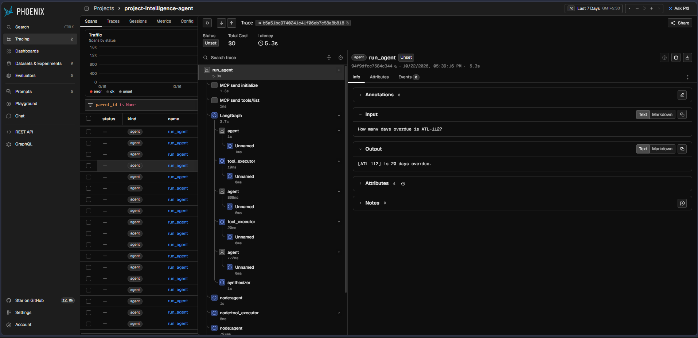

# Project Intelligence Agent

[](https://github.com/KOUK-78/Project-Intelligence-Agent/actions/workflows/test.yml)

**Requires Python 3.12** (CI and the pinned dependencies are tested on 3.12).

Answers multi-step project questions with **verified ticket citations**, every step traced.

**Phase 1: complete, with known limitations.** One vertical slice works end to end: a question goes in, the agent calls Jira tools over MCP, and a cited answer comes out, with every step traced in Phoenix.
Measured, not claimed: see [Results](#results) and [Known limitations](#known-limitations-phase-1).

**Phase 2: in progress** (planner, Notion, email). The measurement side (runner, compare tool, fault injection, tracing, rule tests, contract) is in place; the planner, the two new sources and the Phase 2 keys are other owners' deliverables and **no Phase 2 result has been recorded yet**. See [Phase 2](#phase-2-agentic-core-and-multiple-sources).

```
question -> LangGraph agent (qwen3:8b via Ollama) -> Jira MCP server (stdio) -> cited answer
                          \-> Arize Phoenix trace + logs/runs.jsonl
```

Frozen interfaces live in [`CONTRACTS.md`](CONTRACTS.md). Data is synthetic only (fictional company Northwind, project Atlas).

## Results

Recorded with tracing on, `qwen3:8b`, `--auto --repeat 3` (every run has a trace id). Raw data: `evals/results/phase1_baseline.json` and `evals/results/phase1_heldout.json`.

| Key | Questions passing (all 3 runs) | Runs passing | Latency median / worst |
|---|---|---|---|
| Original (`answer_key.json`, 10 questions) | 7 of 10 | 23 of 30 (76.7%) | 7.9 s / 16.4 s |
| Held-out (`heldout_key.json`, 10 questions) | 6 of 10 | 18 of 30 (60.0%) | 8.6 s / 15.7 s |

- No prompt or code change was tuned against the held-out key, but its failures were read while diagnosing, so it is partly contaminated. Treat the 60% as an honest estimate, not a clean one. A fresh unseen question set is the next step. The gap to the original key is expected.
- The 8B model varies between runs. Three runs of the original key gave 73% to 80% of runs passing, so read these as +/- a few points.
- `--auto` is a citation-level check (status ok, expected citations present, no forbidden citations, no invalid IDs). It does not read the answer text. See limitations.
- Earlier tuning runs (heuristics on/off) are kept in `evals/results/history/`. They were recorded without tracing and are not the baseline.

### A trace in Phoenix



## Failing questions and causes

Causes are from reading the traces of the failing runs (`AGENT_DEBUG=1`). Runs failing = out of 3. Reasons are the ones the runner recorded.

| Key | Q | Question (short) | Runs failing | Recorded reason | Cause |
|---|---|---|---|---|---|
| Original | Q6 | When is the Atlas public launch? | 3 | missing `ATL-139` | Retrieval depth: the agent opens only the first search hit, cites `ATL-103` and states one date. The two launch tickets conflict, but `ATL-139` is never read, so the conflict is not flagged. |
| Original | Q7 | Status of the Salesforce CRM integration? | 1 | forbidden `ATL-114` | Tangent after a not-found: the agent adds a related ticket it should not cite. The other 2 runs are clean. |
| Original | Q9 | Is the overdue privacy ticket late because of the payments API? | 3 | forbidden `ATL-112` | Premise check: the agent correctly says no, but cites the payments ticket it just ruled out. The key forbids that citation; whether that is too strict is for A to decide. |
| Held-out | H4 | Is the penetration test delayed because of the payments API? | 3 | missing `ATL-136`, forbidden `ATL-112` | The agent searches the suggested cause instead of the pen-test ticket, so it never cites it and cites the payments ticket. |
| Held-out | H5 | Which tickets are due on 2026-06-30, and are they overdue? | 3 | missing `ATL-116`; run 1 also forbidden `ATL-112`, `109`, `118`, `121`, `127`, `133` | Wrong tool: a due-date question is answered from the overdue list, so the ticket due that day is missed. Run 1 also lists the whole payments chain. |
| Held-out | H7 | Which overdue tickets are not caused by the payments API delay? | 3 | `status=loop_cap`, missing `ATL-109` | Step cap: the agent reads tickets one at a time and hits the 5-step limit before answering. |
| Held-out | H10 | How many tickets are labeled launch, and how many are still To Do? | 3 | missing `ATL-103`, `131`, `139`, `140` | Counts are right but no ticket is cited. A hand grader would pass it; the auto check cannot. |

Not covered by the table: `--auto` does not read answer text, so a wrong answer with correct citations passes.

## Phase 2: agentic core and multiple sources

**Goal:** answer questions that need evidence from Jira, Notion and email. The agent plans sub-questions, retrieves evidence per sub-question from the right source, checks whether the evidence is enough, and writes a cited answer. It says "not enough evidence" or "source unavailable" instead of guessing.

**Status:** measurement tooling done; no Phase 2 numbers recorded. Every number below is either copied from a recorded result file or marked *not recorded*.

### Architecture

```
Question -> Planner (validated JSON sub-questions, each tagged with a source)
  -> for each sub-question, in order (one model on the GPU, no parallelism):
       Retrieval loop (the Phase 1 agent + tool_executor nodes, scoped to that source's tools,
                       MAX_AGENT_STEPS per sub-question)
       -> Evidence check (code checks first, then a small-model yes/no)
       -> insufficient and budget left: rewrite the query once, else mark unresolved
  -> Synthesizer v2 (cites any source ID, flags conflicts, says "not enough evidence" / "source unavailable")
  -> citation verifier -> AgentResult
```

| Rule | Where it is enforced |
|---|---|
| `PLANNER_ENABLED=false` reproduces Phase 1 exactly | `config.PLANNER_ENABLED` (default off); `--no-planner` runs; Phase 1 regression gate below |
| IDs are `ATL-` (Jira), `NTN-` (Notion), `EML-` (email) | `CONTRACTS.md` section 10, `config.SOURCE_ID_PREFIXES` |
| A failed source does not stop the run | `FAULT_INJECT` tests; `AgentResult.sources` |
| Hard caps everywhere | `MAX_AGENT_STEPS=5` per sub-question, `MAX_TOTAL_STEPS=15`, `MAX_SUBQUESTIONS=4` |
| No data, titles, names or key wording in prompts | `tests/test_prompt_hygiene.py` (all three sources) |
| The Phase 2 held-out key is measurement-only | `CONTRACTS.md` section 7; tests never quote its wording |

The contract (new tool names, optional `AgentResult` fields, key fields `sources_required` and `must_mention`, hook points) is [`CONTRACTS.md`](CONTRACTS.md), sections 3 to 12.

### Measurement tools

```bash
python -m evals.run_evals --phase2 --flat --auto --repeat 3          # -> phase2_flat.json (flat mode: planner off, ENABLED_SOURCES=all)
python -m evals.run_evals --phase2 --no-planner --auto --repeat 3   # -> phase2_jira_only.json (Phase 1 graph; NOT a flat baseline)
python -m evals.run_evals --phase2 --planner    --auto --repeat 3   # -> evals/results/phase2_planner.json
python -m evals.run_evals --phase2 --heldout --planner --auto --repeat 3   # -> phase2_heldout.json (M4 only)
python -m evals.compare evals/results/phase2_flat.json evals/results/phase2_planner.json
python -m evals.compare evals/results/phase1_baseline.json evals/results/phase1_baseline_planner.json   # regression gate
```

Each run records sources cited versus `sources_required`, the `must_mention` check, planner validity and fallback, sub-question count, step and token totals, and the machine, Ollama model digest and git commit it was recorded with. `compare` prints per-question deltas and **exits 1** if the candidate passes fewer than 22/30 runs on the original key or 15/30 on the held-out key (the bottom of the recorded Phase 1 ranges), and 2 if the files cannot be compared. It warns when two files come from different machines, model digests or repeat counts, or when fault injection was on. Fault injection is described in [`docs/SETUP.md`](docs/SETUP.md#fault-injection).

### Which sources a run reaches (`ENABLED_SOURCES`)

| Planner | `ENABLED_SOURCES` | What runs |
|---|---|---|
| off | unset | Phase 1 graph, Jira only (regression mode; not a flat baseline) |
| off | `all` or a list (`jira,notion`) | **Flat mode**: those sources behind one router and ONE retrieval loop over all their tools |
| on | unset | planner over every source |
| on | `all` or a list | planner over just those sources |

Names are `jira`, `notion`, `email`; a bad value stops the run with an error. `evals.run_evals` sets the variable itself (`--flat` sets `all`; `--no-planner` removes it so a value left in your shell cannot turn a Jira-only run into a flat one) and records `enabled_sources` in the result file. Thread IDs (`THR-...`) are in `NON_CITABLE_ID_PREFIXES`: the verifier ignores them, they are never citations.

### Flat versus planner (Phase 2 key)

| Run | File | Questions passing | Runs passing | Median / worst latency | Median tokens per run | Trace IDs |
|---|---|---|---|---|---|---|
| Flat (one loop over all sources, no planner) | `phase2_flat.json` | *not recorded* | *not recorded* | *not recorded* | *not recorded* | *not recorded* |
| Planner on | `phase2_planner.json` | *not recorded* | *not recorded* | *not recorded* | *not recorded* | *not recorded* |
| Held-out, planner on | `phase2_heldout.json` | *not recorded* | *not recorded* | *not recorded* | *not recorded* | *not recorded* |
| Held-out, flat | `phase2_heldout_flat.json` | *not recorded* | *not recorded* | *not recorded* | *not recorded* | *not recorded* |

Official runs are recorded at M2 and M4 on one machine with one model version and Phoenix on, then this table is filled from the result files (and `compare` output pasted beside it). With the planner off the agent is the Phase 1 graph, which reaches only Jira, so it is **not** a flat baseline: those runs are recorded as `phase2_jira_only.json` and must not be presented as the planner's before/after. `phase2_flat.json` is the real baseline: `--flat` runs the planner off with `ENABLED_SOURCES=all`, one retrieval loop over all three sources. A planner that does not beat flat on the tuning key, or that regresses the held-out comparison, is reported as such.

### Phase 1 regression table

With the planner **off** the Phase 1 numbers must hold. These are the recorded Phase 1 results (the reference) and the floor `compare` enforces.

| Key | Recorded (planner off) | Recorded range | Floor (exit 1 below) | Planner-on re-run |
|---|---|---|---|---|
| Original (`answer_key.json`) | 23 of 30 runs, 7 of 10 questions | 22 to 24 of 30 | 22 of 30 | *not recorded* |
| Held-out (`heldout_key.json`) | 18 of 30 runs, 6 of 10 questions | 15 to 18 of 30 | 15 of 30 | *not recorded* |

### Limitations (Phase 2)

- **Nothing about Phase 2 accuracy is claimed yet.** The tables above are empty on purpose.
- **Run-to-run variance.** The 8B model varies between runs (73% to 80% on the original key in Phase 1). Differences of a few runs between flat and planner are noise; read per-question deltas, not just totals.
- **Citation-level scoring.** `--auto` checks citations, required sources and `must_mention` strings. It does not judge whether the answer is *right*. A `must_mention` check can miss a paraphrase and cannot catch a correct string used wrongly. LLM judging is Phase 4.
- **Small and synthetic.** Three fictional sources, a few dozen items, a small number of questions.
- **Token counts depend on Ollama.** If a reply carries no usage fields, that run reports none and the totals say how many runs reported.
- **One machine.** Official numbers are only comparable with other numbers from the same machine and model digest.
- **Embeddings are not used.** Search is keyword with section-level snippets; embeddings are added only if a measured Notion failure needs them.

## Known limitations (Phase 1)

- **Over-answering.** On "is X caused by Y?" style questions the agent sometimes adds the related blocker and its downstream tickets. The extra citations trip the forbidden-citation check. This is the most common failure on both keys.
- **Conflicting sources.** When two tickets disagree (for example two launch dates), the agent can state one value without flagging the conflict.
- **Aggregate answers can lack citations.** A count or summary can be right in the text while citing no ticket, which the auto check marks as a failure. Hand grading would pass some of these.
- **Step cap.** Some multi-hop questions hit the 5-step cap and return an honest "could not finish" (`status=loop_cap`) instead of an answer.
- **Date edge cases.** "Due on a date" versus "overdue" can be confused at the boundary.
- **Citation-level scoring is approximate.** It can undercount (right answer, no citation) and overcount (right citation, wrong wording). LLM-judge scoring is planned for Phase 4.
- **Small and synthetic.** 45 tickets, one tool source (Jira), 10 + 10 questions. Results are indicative, not statistically strong.
- **Local model only.** Latency (about 8 s median) reflects `qwen3:8b` on an 8 GB GPU.

## Quickstart

### 1. Clone and install

```bash
git clone https://github.com/KOUK-78/Project-Intelligence-Agent.git
cd Project-Intelligence-Agent
python -m venv .venv
source .venv/bin/activate          # Windows: .venv\Scripts\activate
pip install -r requirements.txt
cp .env.example .env               # Windows: copy .env.example .env
```

`.env` is gitignored. The defaults work; fill values only to override them.

### 2. Set up Ollama

Full guide: [`docs/SETUP.md`](docs/SETUP.md). The short version:

```powershell
ollama pull qwen3:8b
ollama pull nomic-embed-text
ollama ps        # PROCESSOR must say 100% GPU
```

Keep `NUM_CTX = 8192` on 8 GB cards and close heavy apps first.

### 3. Run the CLI

```bash
python -m app ask "What is blocking Project Atlas?"
```

Prints answer, citations, status, trace id, latency and tool calls.
The agent launches the Jira MCP server itself as a subprocess; you do not start it.

| Option                  | Use                                             |
| ----------------------- | ----------------------------------------------- |
| `--stub`                | TEST-ONLY fake agent, explicit opt-in (smoke test). There is no silent fallback: if the real agent fails to import, the CLI stops with an error |
| `AGENT_DEBUG=1`         | Decision log on stderr, one line per graph node |
| `JIRA_DATA_PATH=<file>` | Point the MCP server at a different ticket file |

```powershell
$env:AGENT_DEBUG="1"; python -m app ask "..." 2> debug.txt     # PowerShell
```

### 4. Run the answer key

```bash
python -m evals.run_evals                       # original key, grade each answer by hand: p / f / s
python -m evals.run_evals --auto --repeat 3     # no prompts, exit 1 if any question fails
python -m evals.run_evals --heldout --auto --repeat 3
```

| Flag                   | Meaning                                                                 |
| ---------------------- | ----------------------------------------------------------------------- |
| `--key <file>`         | Answer file to run (default `answer_key.json`)                          |
| `--heldout`            | Run `heldout_key.json` (measurement only; cannot be combined with `--key`). With `--phase2`: the Phase 2 held-out key |
| `--phase2`             | Run `phase2_key.json` instead of the original key (cannot be combined with `--key`) |
| `--planner` / `--no-planner` | Switch the planner on or off for this run only (default: `PLANNER_ENABLED`). Picks the result file name |
| `--auto`               | No prompts. A run passes only if status is `ok`, every expected citation is present, no `forbidden_citations` are cited, and every cited ID exists. Exit code 1 if any question fails |
| `--repeat N`           | Run each question N times; reports pass rate per question and overall   |
| `--min-pass-rate 0.67` | Per-question pass rate needed to count as passing (default 1.0)         |
| `--no-grade`           | Record mechanical checks only                                           |
| `--require-trace`      | Exit 1 if any run has no `trace_id`                                     |
| `--stub`               | Plumbing test only; writes `*.stub.json`, never the real result files   |

`--auto` is a citation-level check and does not read the answer text. Hand grading still judges wording.

Results go to separate files: `evals/results/phase1_baseline.json` (original key) and `evals/results/phase1_heldout.json` (held-out key). Phase 2 files: `phase2_flat.json` (planner off), `phase2_planner.json`, `phase2_heldout.json` and `phase2_heldout_flat.json`; a planner run on a Phase 1 key writes `*_planner.json` so a baseline is never overwritten.
The held-out key must not be used to tune prompts or code (see `CONTRACTS.md`). In Phase 1 its failures were read for diagnosis, so it is partly contaminated.
Per run it records: status, citations, expected citations found, forbidden citations hit, invalid IDs, latency and trace id; for Phase 2 keys also sources cited versus required, the `must_mention` check, planner validity, sub-question count, step and token totals. The file header records the machine, Ollama model digest, git commit and settings.

### 5. View traces

```bash
# second terminal
export PHOENIX_WORKING_DIR="$PWD/.phoenix"     # PowerShell: $env:PHOENIX_WORKING_DIR="$PWD\.phoenix"
phoenix serve
```

Open http://localhost:6006. Each run shows the question, every model call, every tool call (inputs and outputs) and timing.
If Phoenix is not running, runs still work and a warning goes to stderr.

Offline fallback: every run is appended to `logs/runs.jsonl` (question, answer, citations, status, tool_calls, latency_ms, trace_id).

### 6. Tests

```bash
pytest
```

CI runs this on every push. The suite includes the rule-policing tests (prompt hygiene, answer keys, contract versus config); some of them switch on automatically once the Notion, email and Phase 2 key files exist.

## Repo layout

```
app/
  config.py, cli.py, tracing.py, runtime.py   platform (C)
  faults.py                                   FAULT_INJECT source failure / timeout (C)
  agent.py, graph.py, nodes/                  agent (B)
  mcp_servers/, nodes/mcp_client.py           MCP servers and client (D; Jira server written in Phase 1)
data/
  synthetic/jira_tickets.json                 synthetic Northwind / Atlas tickets (A)
  generate_jira.py, PRIVATE_NOTES.md          dataset generator and design notes (A)
evals/
  run_evals.py, compare.py                    eval runner and result comparison (C)
  answer_key.json, heldout_key.json           Phase 1 answer files (A)
  phase2_key.json, phase2_heldout_key.json    Phase 2 answer files (A, when written)
  results/                                    phase1_*.json, phase2_*.json, history/
docs/                                         SETUP.md, phoenix_trace.png
CONTRACTS.md                                  frozen interfaces, Phase 2 amendments, ownership
.github/workflows/test.yml                    CI (pytest)
tests/
```

## Rules of the repo

- Model names live only in `app/config.py`.
- "Today" is frozen: `TODAY = "2026-06-30"`. Never use the system date.
- The MCP server must never print to stdout (it carries the protocol). Log to stderr.
- One branch per person, merge by pull request. Dependencies are pinned in `requirements.txt`.
- Phase 2 adds the planner, Notion and email. Out of scope until later phases: memory, guardrails, action approval, GitHub (stretch after M4), FastAPI, UI, automated judging. CI does not run evals (they need Ollama).
